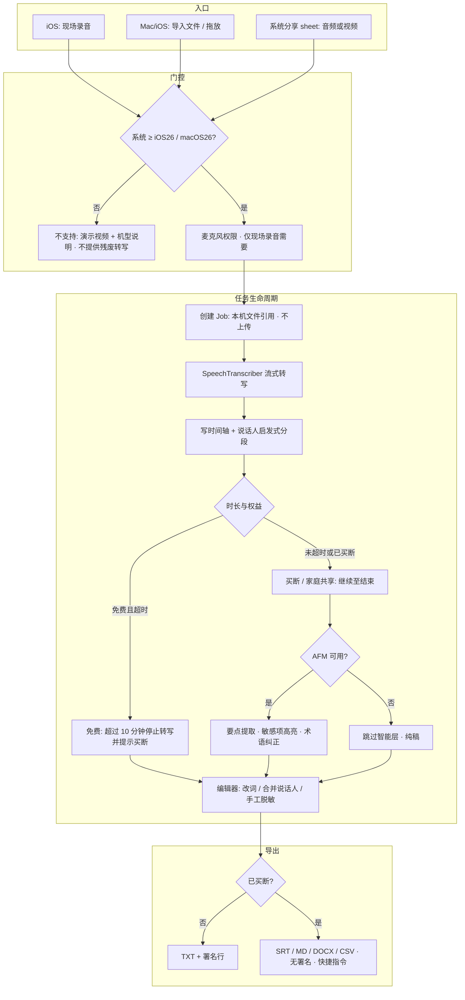
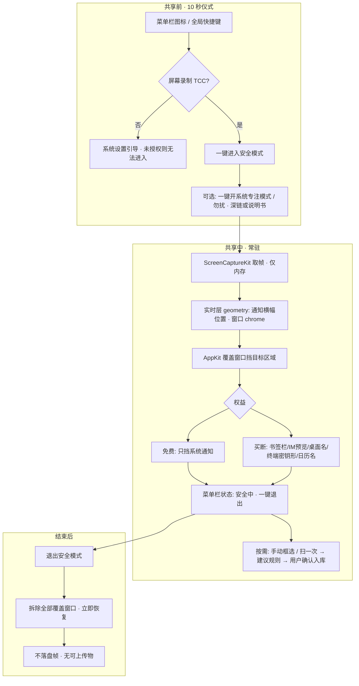
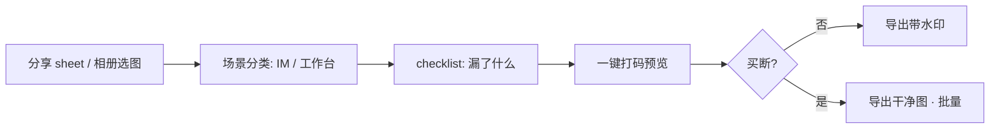

# 端侧买断线 — 立项清单（TODO）与技术选型

> 创建：2026-08-29 · **不属于 HexAstral launch scope**
>
> **与 [ondevice-apple-buyout-line.md](./ondevice-apple-buyout-line.md) 的分工：**
> 那份是**判断依据**（该不该做某方向、筛选器、成本依据套利、AUR、中国区 Gate、资源冲突）；
> 这份是**立项清单**（做哪几个、受众与业务流程、仓库与技术栈、分阶段 TODO）。
> 若两份冲突，**策略以那份为准，执行细节以这份为准**。

---

## 一、一页纸结论

| 问题 | 结论 |
|---|---|
| 做哪几个 | **v1 = D′ RedactBeforeSend**（iOS 视频关键帧打码+图片）；其后 **S** / **F**；R 候补；P 搁置 |
| 先做哪个 | **D′（已锁定）** — 仓库：`../ondevice-apps`（与 hexastral 平级） |
| 同时在架上限 | **1 个** |
| 仓库 | **独立 Swift monorepo `ondevice-apps/`**，不进 hexastral |
| 技术栈 | Swift 6 + SwiftUI · SPM · StoreKit 2 · **无后端** |
| Expo | **不用** |
| 变现 | 一次性买断 + 家庭共享；免费短导出+水印 |
| 共享包 | v1 仅 **BuyoutKit**；第二款再抽 Permission/AppShell/Design |

---

## 二、立项清单

### 2.1 T — 端侧转写（推荐首发）

**一句话：** 会议、讲座、访谈录音在本机转成带说话人的稿子，音频永不上传，一次买断全家可用。

**为什么值得做**

| 判据 | 结论 |
|---|---|
| 成本依据套利 | `SpeechAnalyzer`（iOS 26 / macOS 26）端侧、无时长上限、模型随 OS 出厂 → 打掉 Otter.ai **$99.96/yr** 的定价基础（buyout-line §3.8） |
| 竞品弱点 | MacWhisper $69 / Aiko ~$24 已证明买断可行，但**要打包 GB 级 Whisper 权重**；你的包体几 MB、更快更准 |
| 家庭共享 | **第一天就兑现**：4 人 3 年 → Otter $1,200 vs 你 $39 |
| 硬件门 | 只服务 iOS 26+ / macOS 26+ → 代码更简单，体验更稳（buyout-line §3.5） |
| 技术风险 | **低** —— 无 go/no-go 阻塞项，MAS 分发是常规操作 |

**受众（按付费意愿排序）**

| 层 | 人群 | 为什么privacy 是硬约束 |
|---|---|---|
| 高 ARPU | 律师、心理咨询/医生、HR、记者、投资人（尽调） | NDA / HIPAA / 线人保护 —— 音频上云是**违规**，不是偏好 |
| 广量 | 学生（讲座）、研究者（访谈）、播客、远程工作者 | 时长大、预算低，最恨按分钟计费 |
| 家庭 | 学生家庭、双知识工作者夫妻、替父母转写就诊录音 | 家庭共享的直接买点 |

**场景**

- 开完会：把 90 分钟录音丢进去，出带时间轴和说话人的稿子
- 上完课：讲座录音 → 稿子 + 要点摘要 → 导出 Markdown 进笔记
- 访谈后：转写 + **自动脱敏**（人名、电话、机构）再发给同事
- 就诊后：家人录音 → 医嘱要点，全程不出手机

**业务流程（详细）**

三条入口，汇合到同一条「任务 → 稿子 → 导出」管线。付费闸门卡在**导出与时长**，不卡「能不能看见魔法」。



**关键业务规则**

| 规则 | 设计 |
|---|---|
| 魔法可见 | 免费用户**完整走完** ≤10 分钟文件的转写 + 编辑；第一次就感到「音频没离开本机」 |
| 付费触发点 | ① 文件 >10 分钟 ② 批量第 2 个文件 ③ 导出非 TXT / 去署名 ④ 开摘要·脱敏（可选：免费给一次摘要预览） |
| 进度 | 前台显示进度；Mac 可菜单栏显示「转写中」；杀进程后续传：v1 不要求，文件在则重新跑 |
| 存储 | 音频/视频保持用户原路径或 App 沙盒副本；稿子进本机 SwiftData；**无账号无云** |
| 失败 | 模型下载中 / AFM 拒答 → 降级纯稿 + 文案说明，不假装智能 |
| AUR | 摘要文案固定为「要点提取」，禁止「医嘱建议 / 法律意见」话术 |

**典型用户旅程（开会后 · Mac）**

1. 从 Zoom 导出录音或用本机备忘录  
2. 拖进 App（或分享 sheet）  
3. 3 秒内开始出字 → 看完整篇（若 ≤10 min）或看到买断墙（若更长）  
4. 点「脱敏预览」→ 姓名电话高亮 → 一键导出 MD 进 Obsidian  

**典型用户旅程（讲座 · iPhone）**

1. 课前打开 App → 开始录音（锁屏可继续，视后台音频策略）  
2. 下课停止 → 自动建 Job 转写  
3. 通勤时在手机上改错词 → 回家 Mac 上同一 Apple ID 若 v1 无云同步则 **各设备各自文件**（v1 不承诺跨端稿件库；通用购买只共享**购买权**）

⚠️ **v1 明确：购买权家庭共享 / 通用购买 ≠ 稿件云同步。** 避免和「音频不出设备」叙事打架。

**免费 / 付费切分**

| | 免费 | 买断 $39（区间 $29–49） |
|---|---|---|
| 转写 | 单文件 ≤ 10 分钟 | **无限时长** |
| 批量 | 1 个 | 队列批量 |
| 导出 | TXT，带一行署名 | SRT / Markdown / DOCX / CSV，无署名 |
| 智能 | 稿子；摘要可「试一次」 | 摘要 + 脱敏 + 术语本 |
| 平台 | 单端试用 | **通用购买 Mac + iPhone + iPad** |
| 家庭 | — | **6 人共享** |

**平台分工**：Mac 吃长音频批量与导出（高 ARPU），iOS 吃现场录音采集（低摩擦入口），一次买断覆盖两端。

**主要风险**

- `SpeechTranscriber`（长音频）**不支持 contextualStrings**（自定义词表）；术语纠正要靠 AFM 后处理或 `DictationTranscriber` 走短句路径
- 说话人分离在 Apple 框架里能力有限，可能需要自己做启发式（按静音间隔 + 声道）
- 「摘要」类输出受 AUR 约束：**不得**对个人产出实质影响结论（医疗/法律建议）—— 只做「要点提取」不做「建议」

---

### 2.2 S — 屏幕隐私（macOS 实时遮挡 + iOS 截图预检）

**一句话：** macOS 上共享/录屏时一键进入安全模式，自动遮挡通知、书签栏、终端密钥、客户名；iOS 上只做发前截图预检（**不是**手机录屏实时挡 —— 系统做不到）。

**平台为何必须这样切：**

| | macOS | iOS / iPadOS |
|---|---|---|
| 录屏进行中挡泄密 | ScreenCaptureKit + 覆盖窗口 → **能** | 无系统级浮层、插不进控制中心录屏管线 → **不能** |
| 发前静态预检 | 次要 | 分享 sheet 进 App → checklist + 打码 → **能** |

这正是产品名里的分工：**屏幕隐私 = macOS 实时遮挡 + iOS 截图预检**。

**为什么值得做**：创始人**个人已验证需求**，且已存在很烂的 workaround（专用浏览器 profile、新建访客账户、共享前手动关通知、只敢共享单窗口）—— buyout-line §2.1。护城河是逐 App 区域规则库 + Evaluations 回归集，抄袭成本高。演示媒介就是产品本身。

**受众**

| 层 | 人群 | 痛点 |
|---|---|---|
| 主 | 远程工作者、开发者、咨询/销售 | 共享屏幕时通知弹出客户名；终端里有密钥；书签栏暴露内部系统 |
| 次 | 录课博主、技术支持客服 | 录制后才发现要重录 |

**场景**：Zoom/Teams 共享桌面前 · 录课 · 客户演示 · 直播技术分享 · 截图发群（iOS 端）

**业务流程 — macOS 实时遮挡（v1 主路径）**

设计成「开会仪式」三拍：进模式 → 共享中保驾 → 退出恢复。免费档只挡通知，保证每天都愿意开着。



**关键业务规则（Mac）**

| 规则 | 设计 |
|---|---|
| 默认路径 | **确定性 geometry**，不跑模型；AFM/Vision 只在「扫一次 / 框选」时触发 |
| 免费留存 | 只挡通知也要**足够好用**，用户养成「开会先点一下」；付费是挡更深的区域 |
| 多显示器 / Space / 全屏 | 覆盖窗口必须跟对空间；跟丢则菜单栏提示「安全模式降级」而非静默漏挡 |
| 权限被关 | 立刻退出安全模式并提示，禁止「假装还在挡」 |
| 与 Zoom | **不 hook Zoom**；用户照常点共享桌面，挡的是屏幕上看得见的区域 |
| 演示获客 | 录一段「通知弹出客户名 → 一键盖住」即 ASO / 短视频素材 |

**典型用户旅程（客户演示）**

1. 开会前 10 秒：快捷键进安全模式（免费已挡通知）  
2. Zoom 共享桌面 · 演示中 Slack 弹消息 → 横幅已被盖  
3. 买断用户：Safari 书签栏客户内网域名也被盖  
4. 散会：快捷键退出，桌面恢复原样  

**业务流程 — iOS 截图预检（v2，同一产品加平台）**



**免费 / 付费切分**

| | 免费 | 买断 $19.99 |
|---|---|---|
| Mac 遮挡 | **只盖系统通知横幅** | 书签栏/标签 · 邮件与 IM 预览 · 桌面文件名 · 终端密钥形状串 · 日历客户名 |
| 规则 | 内置 | 自定义区域 + 导入导出 |
| iOS 预检（v2） | 单张 + 水印 | 去水印 + 批量 |
| 家庭 | 开但不主打文案 | 6 人（价值偏低，零成本仍开） |

**主要风险（两个必须先做探针，见 buyout-line §5.7）**

1. **MAS 沙盒是否允许「屏幕录制 + 覆盖窗口」组合** —— 若不允许只能走 Developer ID 分发，那会同时失去 App Store 分发位、家庭共享和通用购买，**整个商业模型要重写**。这是 go/no-go。
2. **实时路径算力预算** —— 60fps 不可能逐帧跑模型；必须分层（确定性 geometry 跑实时，模型按需）。

---

### 2.3 A/B 录制合成 —— **市场核实后不单独立项**

| 能力 | 结论 | 证据 |
|---|---|---|
| **A. 双物理摄像头** | 不进主线 | 竞品满 + DoubleTake |
| **B. 脸 + 屏幕合成** | **不单独立项**（有小众市场，但不值得占名额） | buyout-line §3.7 市场核实 |
| **S. 录屏/共享时隐私遮挡** | **主线 · macOS 实时**；iOS 只做截图预检 | 见下 · 与 §2.2 一致 |

**平台边界（必须写死）：**

| | macOS | iOS / iPadOS |
|---|---|---|
| 录屏/共享**进行中**智能挡通知与敏感区 | **能**（ScreenCaptureKit + 覆盖窗口） | **不能**（无系统级浮层；插不进系统录屏管线） |
| 发前对截图/静态画面预检打码 | 次要 | **能**（分享 sheet → 你的 App） |

「系统与 DemoScope 都不做智能挡」这句话的缺口在 **Mac**，不是再做一个 iOS 录屏隐私 App。

---

### 2.4 D′ — 发前隐私（**可立项切片：视频打码导出 + 图片打码**）

**一句话：** 不卖「更聪明的静态打码」（DAMA 主场），卖 **「发出去之前的净版视频/图」**——DAMA 不做视频，这是硬差。

**立项条件（2026-08-30 拍板）：** 端侧 **视频抽帧打码导出** 成立，再 **补足图片打码** → **可以立项**。不靠云 VLM。

**禁止做成：** 仅静态图 + 正则的 DAMA 壳。

---

#### 工程约束：发热 / 耗电 / 后台（写死）

| 问题 | 结论 |
|---|---|
| **会明显发热耗电吗？** | **会**，若每帧全分辨率跑文字检测+重编码。解码 + Vision + 编码是三件重活叠在一起。 |
| **必须 App 一直打开吗？** | **长视频：实质要保持 App 在前台（或至少进程不被杀）**。iOS **不能**可靠地保证「锁屏丢后台跑完 10 分钟导出」。 |
| **后台能干什么？** | `beginBackgroundTask` 只多几十秒～约几分钟缓冲；`BGProcessingTask` **不保证何时跑、也可能永不跑**。只适合「用户离开前已基本跑完」或极短片收尾，**不能**当主交付承诺。 |

**更好的策略（产品必须采用，否则差评在发热）：**

1. **降采样检、全分辨率画** — 检测用 720p/半分辨率；马赛克框映射回原分辨率再烧进导出轨。  
2. **抽帧 + 跟踪，禁止默认「每帧 OCR」** — 例如每 5–10 帧检一次人脸/文字区，中间用 `VNTrackObjectRequest`（或光流/插值框）；场景切变再全检。  
3. **检测档可配** — 默认「人脸 + 明显文字块」；「精细文字/车牌」作慢档或付费档，并明示更耗电。  
4. **分段流水线** — 先快速扫出时间轴红区（预览级），用户确认后再「导出烧录」（第二次更重，但次数少）。  
5. **时长门** — 免费/体验限 60–90s；更长要插电提示或「建议接电」。  
6. **硬件编码** — `AVAssetWriter` + VideoToolbox；打码尽量 Metal/CI 在 GPU。  
7. **UX 诚实** — 进度 + 温度友好文案：「处理中请勿切走」；切走则暂停/失败可恢复队列，**绝不承诺静默后台跑完**。

```text
导入视频
  → [快扫] 降采样抽帧 + 跟踪 → 时间轴标红（可关某段）
  → 用户确认
  → [导出] 按确认框烧录 + 硬件编码 → 相册/分享
  （全程建议前台；后台不作为 SLA）
```

图片路径：分享 sheet / 相册 → 同套检测规则 → 清单 → 导出或继续分享（可与视频共用引擎，无时间轴）。

---

#### 使用说明（产品必须说清楚 · 降低发热与差评）

写进 onboarding / 导出前 Checklist，不是藏在帮助页：

| 说明 | 为什么 |
|---|---|
| **尽量一条连续镜头**，少硬切、少快切 | 切镜 = 关键帧变多 = 更烫更慢 |
| **画面相对稳定**，避免剧烈晃动、快速甩镜 | 跟踪更稳，少跟丢重检 |
| **单段不宜过长**（引导 15–60s 发帖向）；更长建议分段处理 | 导出重编码与热累积 |
| **处理/导出时请保持 App 在前台**，勿锁屏切走 | iOS 后台不可靠 |
| **长片建议接电、降亮度** | 诚实管预期 |
| **默认「人脸」够用再开「文字」** | 文字检更重 |
| **先预览时间轴再导出** | 避免反复烧录 |
| 效果声明：跟丢/新入画可能漏检 → 可手动补框 | AUR / 预期管理 |

算法叙事（商店可写）：**关键帧智能标注打码 → 动态跟随；镜头切换时自动重新标注。**

---

#### 变现：买断为主，不要用「每日额度 → 订阅」撑主模型

**本机推理边际成本 ≈ 0** → 订阅没有成本依据（buyout-line §3.8）。  
「每天固定导出时长 + 水印，超出订阅」**短期能做闸门，但很难长期撑住**：

| | 每日额度 + 订阅 | 水印/时长门 + **一次性买断** |
|---|---|---|
| 成本叙事 | 弱（用户知道算力在手机上） | 强（和 DAMA 同构：去掉脏东西） |
| 差评风险 | 高（「本地 App 还按天限」） | 中（水印/单段时长人人熟悉） |
| 家庭共享 | 订阅席位别扭 | **第一天兑现** |
| 使用形态 | 晒娃/发帖是**偶发突发**，日额度体验差 | 买断后随时导出，符合真实频率 |
| 支撑力 | 难撑；像在惩罚正常使用 | **能撑**；对标隐私工具买断 |

**推荐模型（D′）：**

| | 免费 | 买断（建议 **$9.99–19.99**，开家庭共享） |
|---|---|---|
| 预览 / 时间轴标注 | ✅ 完整魔法可见 | ✅ |
| 导出视频 | 短片（如 ≤30–60s）+ **水印** | 去水印；单段上限放宽（如 3–5 min） |
| 导出图片 | 带水印或每日少量张 | 去水印 + 更宽松 |
| 精细文字检 / 批量 | 可选锁 | ✅ |
| **不要** | — | **不要**把「每日分钟数订阅」当主 SKU |

可选：免费档加很松的「每日导出次数」（如 3 次）防刷商店录屏，**超限提示买断而非订阅**。

仅当以后加 **云 VLM 增强审片** 时，再单开订阅档（有真实账单）；与本机买断拆开卖。

---

#### 视角 A —「发前闸」（图 · 可并入同 App）

| | |
|---|---|
| **谁** | 会截图转发的所有人（办公尤甚） |
| **怕什么** | 发出去才发现书签栏 / 通知 / 订单号还在 |
| **入口** | 系统分享 sheet → 「发前检查」；或截图后 Action Extension |
| **流程** | 选目标 App（微信/邮件/Slack）→ 本机扫图 → **清单 UI**（可勾选抹哪些）→ 一键出净图并继续分享 |
| **与 DAMA 差在哪** | 入口是**分享路径上的闸**，不是相册里的编辑器；输出是「继续发出」不是「存回相册」 |

```text
截图 / 相册选图
    → 分享 sheet 点「发前检查」
    → 清单：□ 手机 □ 邮箱 □ 人脸 □ 通知条 □ 自定义
    → [抹选中项并继续分享]  → 目标 App
```

---

#### 视角 B —「晒娃 / 家庭外发」

| | |
|---|---|
| **谁** | 父母、宝妈 |
| **怕什么** | 娃脸 + 书包校徽 + 门牌 + 定位水印一起发朋友圈 |
| **入口** | 「家庭相册」模式：导入多图批量闸 |
| **流程** | 选场景模板「朋友圈晒娃」→ 预设规则（脸模糊强度、去门牌、去 EXIF）→ 批量出净图 |
| **买断钩子** | 家庭共享：配偶同一规则包 |
| **与 DAMA 差在哪** | **场景模板 + 批量家庭规则**，不是通用 PII 正则 |

---

#### 视角 C —「客服 / 电商工单外发」

| | |
|---|---|
| **谁** | 个体卖家、客服、财务报销 |
| **怕什么** | 聊天截图带客户手机；面单发群；报销单带银行卡 |
| **入口** | 拍照 / 导入 → 选模板「面单」「聊天」「报销」 |
| **流程** | OCR → **双输出**：① 脱敏图（可发群）② 结构化字段（单号/金额，仅本地或导出 CSV） |
| **与 DAMA 差在哪** | **同一动作两个产物**（脱敏 + 抽取）；业务是「对账还不泄密」 |

---

#### 视角 D —「会议纪要外发」

| | |
|---|---|
| **谁** | 远程办公、咨询顾问 |
| **怕什么** | 纪要 PDF/长截图里有客户名、金额、未公开项目名 |
| **入口** | 文件 / 长图导入；可与 S Mac 录屏遮挡同品牌 |
| **流程** | 检 → 清单（实体名可点进原文高亮）→ 红acted 导出 +「已抹项报告」给合规自查 |
| **与 DAMA 差在哪** | **报告型输出**（给老板/合规看「抹了什么」），不是糊完就完 |

---

#### 视角 E —「视频发前净版」（**v1 主切片 · 对 DAMA 硬差**）

| | |
|---|---|
| **谁** | 晒娃、街拍、探店、发客户现场片的人 |
| **怕什么** | 视频里路人脸、门牌、屏幕上的字一起发出去；DAMA 管不了视频 |
| **入口** | 相册选视频 / 分享 sheet |
| **流程** | 快扫时间轴 → 确认 → 导出打码版（策略见本节「工程约束」） |
| **与 DAMA 差在哪** | **视频导出打码**；图是补足不是主叙事 |

---

**立项建议（已更新）：**

- **v1 切片：** 视频打码导出（E）+ 图片打码/发前闸（A）共用检测引擎 → **已满足可立项条件**
- B/C 模板后期；D 报告型更后期
- 与 **S Mac 录屏实时遮挡** 是不同 job；**同时在架仍 ≤1**，S 与 D′ 谁先占位需另拍

---

### 2.5 F — 家庭文件柜（成立 · **排在 S / 录屏隐私之后**）

**一句话：** 「空调保修到几号」+ 到期提醒 + 家庭共享 —— 文档进柜、字段抽齐、全家同看。

**排序（已拍板）：** **S（含 Mac 录屏遮挡）先发 → F 作第二款**（渠道验证后再开）。不与 S 抢首发。

**为什么成立**

| 判据 | 结论 |
|---|---|
| 痛点 | 保修卡 / 保单 / 护照 / 合同散落；到期才想起来；家人互问「存哪了」 |
| 魔法 | 拍照/导入 → OCR + 端侧抽取「品类 · 到期日 · 保修电话」→ 本地库 + 系统提醒 |
| 家庭共享 | 一人买断，配偶/父母同柜（CloudKit 共享区） |
| 不做的事 | 不当 Raycast/Spotlight 替代品 |

**核心字段（v1）：** 标题、品类、到期日、提醒日、附件缩略图、备注、所属成员。

**免费 / 付费：** 免费少数件+提醒；付费无限件、家庭共享、批量导入、导出备份。

**风险：** 到期日抽取评测；AUR 勿承诺法律效力。

---

### 2.6 R — LiDAR 量房（以业务出发，禁止「会扫就行」）

**硬件门：** `RoomCaptureSession.isSupported` → 仅 **LiDAR** 机型（iPhone 12 Pro+ Pro 线 / 部分 iPad Pro）。非 Pro 不装；商店文案必须写清。

**禁止做成：** 「扫一下出平面图」的 RoomPlan demo 壳（苹果 Sample、Magicplan 等已占位）。

**必须从真实任务反推：**

| 业务角 | 用户要完成什么 | App 交付物 | 与 HexAstral 关系 |
|---|---|---|---|
| **自装修** | 量现房、算面积、给工人/设计师看 | 带尺寸平面图、墙长、门窗位置、导出 PDF/USDZ | 独立工具 |
| **风水布局** | 量完房间再摆家具/看气口方位 | 平面 + 朝向/方位叠加 + **规则引擎**建议（非开放域 LLM 玄学闲聊） | 可与 feng 产品线**概念相邻**，代码仍独立仓库；文案走娱乐/文化勿碰医疗承诺 |
| **画图 / 出图** | 给电商定制柜、窗帘、地暖报价 | 可标注尺寸的矢量/CAD 友好导出（DXF/SVG/PDF） | 垂直 B 端轻工具 |

**买断故事：** 免费扫一间看图带水印；付费多房间、无水印导出、模板（厨房柜体清单等）。**家庭共享**对装修家庭成立（夫妻同看方案）。

**不做：** 云端装修报价市场、设计师撮合、需要持续服务器的协作白板（那是另一类生意）。

---

### 2.7 P — 自动化播客

**成立条件（你已定）：可克隆。** → **当前不立项。**

| 路径 | 端侧能否「克隆出可发播客的音频文件」 | 判读 |
|---|---|---|
| **系统 Personal Voice** | **否（产品可用意义上）** | 仅本人、**非商业**；主给 AAC；第三方**不能**把 Personal Voice **录成文件**当播客素材 |
| **系统 AVSpeech / 预制声线** | 能 TTS，**不能克隆** | 不够成立条件 |
| **自带权重（MLX + Qwen3-TTS 等）** | **技术上能**（Mac Apple Silicon；高端 iPhone 已有 Echovo / Vocello 类） | 要下 **~2GB 级模型**、热/内存门、自养推理 —— **违背「OS 做重活」**；商店已有同构竞品；同意书/AUR 成本高 |
| **云克隆（ElevenLabs 等）** | 能，非端侧 | 订阅账单回来，音频出设备 |

**结论：** 以可克隆为硬门时 P **暂不成立**。等系统级「可导出文件 + 可商用 + 本人同意链」克隆 API；或另开「自带模型工作室」线（别挂纯本机买断叙事）。

（CF 托管/队列架构仍成立，但是**管道**；没有克隆卖点就不够你定的成立条件。）

---

### 2.8 候补池

| 方向 | 状态 | 复用什么 |
|---|---|---|
| T 端侧转写 | 仅当与备忘录/系统能力差够大（长稿、说话人、脱敏导出） | SpeechAnalyzer |
| ④ 面单 / 票据脱敏 | 可并入 D′ 垂直场景 | OCR + 打码 |
| ⑦ 旅行证件包 | 可并入 F 品类模板 | OCR + 提醒 |
| ② 诈骗软预警 | 候补，非 v1 | 规则 + OCR/ASR |

### 2.9 明确不做

| 方向 | 否决理由 |
|---|---|
| **DAMA 同壳打码** | 交互/业务无差维度 → 会被当成换皮 |
| **「会扫房」Demo 壳** | 无装修/风水/出图任务闭环 |
| **播客 P（以可克隆为门）** | 系统路径不可商用导出；自带模型≠本线哲学 → **暂不立项** |
| **A 双物理摄像头 / B 独立脸+屏录制** | 见前；系统与竞品已占 |
| **手机 VTuber** | Memoji 无 API；生态满 |
| **Mac AI 泛归档 / 开放域生成** | 筛选器不过；成本逼订阅 |

---

## 三、排序（已锁定）

| 顺序 | 产品 | 说明 |
|---|---|---|
| **1 · v1** | **D′ RedactBeforeSend** | 代码在 `ondevice-apps/`；关键帧打码+跟踪式跨度；买断+水印 |
| **其后** | **S Mac 录屏遮挡** | stub；渠道验证后再开 |
| **其后** | **F 家庭文件柜** | stub |
| 候补 | R 量房 | |
| **搁置** | **P 播客** | 可克隆门 |

**D′ 下一步：** 真机填 [ondevice-apps/Docs/probes/2026-08-30-phase0.md](../../../ondevice-apps/Docs/probes/2026-08-30-phase0.md) 热/后台项。

---

## 四、仓库结构：独立 Swift monorepo

**结论：新建独立 git 仓库 `ondevice-apps/`，不进 hexastral。**

**为什么不进 hexastral**

| 冲突点 | hexastral | 端侧线 |
|---|---|---|
| 包管理 | bun + turbo | SPM |
| 格式化 | biome | swift-format |
| 构建/发布 | EAS · wrangler | Xcode · notarize · MAS |
| 变现 | RevenueCat 订阅 | StoreKit 2 买断 |
| 节奏 | 卫星矩阵 + 9 语言 | 单 App 深做 |

两条线**共享的是创始人时间与审核额度，不是代码**（buyout-line §10.3）。放同一仓只会让 `bun install` 和 Xcode 互相踩。

**为什么端侧线内部要 monorepo**：D′ / S / F（以及以后的 R）共用商业化层（买断 + 家庭共享 + 免费档闸门）、权限引导、设计 tokens、Evaluations。StoreKit 2 的 `ownershipType` / `revocationDate` 写两遍必发散。**领域引擎不硬揉**：视频跟踪打码 ≠ ScreenCaptureKit ≠ 保修 OCR。

```text
ondevice-apps/                    # 独立 git 仓库（≠ hexastral）
  Apps/
    RedactBeforeSend/             # D′ — iOS：视频关键帧打码+跟踪 · 图片打码
      Domain/DetectTrackExport/
    ScreenPrivacy/                # S — macOS 先行：录屏/共享实时遮挡
      Domain/MaskEngine/
    FamilyVault/                  # F — 家庭文件柜（第二款后）
      Domain/DocExpiry/
    # RoomScan/                   # R 候补
  Packages/
    BuyoutKit/                    # StoreKit 2 买断 · 家庭共享 · 水印/时长闸 · 恢复购买
    PermissionKit/
    AppShell/
    EvalKit/
    DesignKit/
  Package.swift
  ondevice-apps.xcworkspace
```

**抽包时机：** 第一个 App 先落地 `BuyoutKit`；第二个 App 立项时再抽 Permission/AppShell/Design。不要空仓五包。

**同时在架仍 ≤1**：mono 里可以多 App 工程，商店只上架一个。

---

## 五、技术栈选型

| 层 | 选型 | 理由 / 备注 |
|---|---|---|
| 语言 | **Swift 6**（strict concurrency） | `SpeechAnalyzer` 是 actor-based，并发检查省下大量竞态调试 |
| UI | **SwiftUI 为主，AppKit 补位** | 覆盖窗口、菜单栏、多显示器必须落到 AppKit（`NSWindow` level / `NSStatusItem`） |
| 依赖管理 | **SPM only** | 不引入 CocoaPods / Carthage |
| 三方依赖 | **尽量为零** | 核心能力全在系统框架；引入第三方等于给「零边际成本」上税 |
| 转写 | `Speech` → `SpeechAnalyzer` + `SpeechTranscriber` | iOS 26+ / macOS 26+；`DictationTranscriber` 走需要自定义词表的短句路径 |
| 屏幕 | `ScreenCaptureKit` + AppKit overlay | 仅 macOS |
| 视觉 | `Vision` + `FoundationModels`（`OCRTool` / 图像 attachment） | 逐设备探测降级，不逐 OS 判断 |
| 摘要/抽取 | `FoundationModels` + `@Generable` 结构化输出 | AUR：只做「提取」不做「建议」 |
| 质量保障 | **Evaluations framework** + Swift Testing | Evaluations 是护城河载体，不是可选项 |
| 变现 | **StoreKit 2** 非消耗型 IAP | 必须正确处理 `ownershipType == .familyShared` 与 `revocationDate` |
| 数据 | 本机文件 + SwiftData（仅 T 的稿子库） | S 无持久数据；**v1/v2 不上 CloudKit** |
| 后端 | **无** | 这是买断成立的前提 |
| 格式化/静态检查 | swift-format + Xcode 警告零容忍 | |
| 分发 | Mac App Store + iOS App Store，通用购买 | S 的 MAS 可行性待探针确认 |
| CI | **无**（与 HexAstral 一致，本地验证） | 本地 `xcodebuild test` + eval-runner |

---

## 六、Expo 的位置：这条线不用，HexAstral 继续用

**结论：端侧线全部原生，Expo 不参与。**

| 需要的能力 | RN / Expo 现状 |
|---|---|
| `ScreenCaptureKit` + AppKit 覆盖窗口 | 无封装，且 RN 不做 macOS 桌面 App |
| `SpeechAnalyzer`（长音频、actor-based） | 无封装 |
| `FoundationModels` 图像 attachment / `@Generable` | 无封装 |
| StoreKit 2 家庭共享语义 | 封装不完整，`ownershipType` 处理易错 |
| Mac App Store 通用购买 | 不适用 |

**HexAstral 仍然必须用 Expo**：Android/Play、9 语言、`@zhop/*` 共享包、Web、EAS 流水线、RevenueCat 订阅 —— 这些端侧线一个都不需要。

**唯一合理的交叉点**：将来 HexAstral 若想用 Foundation Models 做本机小任务（例如 Yuun 的本机摘要），写一个 Expo native module 引入即可。那是叶子能力，不改变主栈，**也不构成合并两条线的理由**。

---

## 七、分阶段 TODO

### 阶段 0 — 前置（2–3 周）

- [ ] buyout-line §10.4 **HexAstral 停损清单 H1–H5 全部勾选**（未完成不开 Xcode 工程）
- [ ] 新建独立 git 仓库 `ondevice-apps` + workspace 骨架
- [ ] **需求验证**：一周日志 —— 会议后是否已在用蹩脚方法记录/回顾（T）；每次「差点暴露」（S）
- [ ] 竞品实测：装 MacWhisper / Aiko / Otter 免费档，记差评与缺口
- [ ] **探针：`SpeechAnalyzer` 真机跑通** 90 分钟音频，测速度、内存、发热
- [ ] 穿插做 S 的探针 A（MAS 沙盒屏幕录制 + 覆盖窗口）—— 结果决定 S 的商业模型
- [ ] Evaluations 黄金集：10–20 段带口音/远场/多说话人音频 + 人工校对稿

### 阶段 1 — T v1（6–10 周）

- [ ] 导入音频/视频 + 现场录音，OS 门检测与不支持时的诚实提示
- [ ] `SpeechTranscriber` 长音频转写 + 时间轴
- [ ] 说话人分段（启发式起步，不承诺精度）
- [ ] 稿子编辑器：改词、合并说话人、标记敏感项
- [ ] AFM 可用时：要点提取 + 自动脱敏；不可用时纯稿子路径（必须可演示）
- [ ] `BuyoutKit`：买断 + 家庭共享 + 免费档 10 分钟闸门 + 恢复购买
- [ ] 导出 TXT/SRT/Markdown/DOCX + 快捷指令
- [ ] 通用购买配置（Mac + iOS 同 bundle）
- [ ] App Store 隐私标签：**不收集**（音频不出设备）
- [ ] ASO：主打「音频不出设备 / 无限时长 / 一次买断全家 6 人」，对比 $99.96/yr

**内部里程碑（非发布门控）**：第 3 周末做到「自己开完会真的会用它转写」。做不到先改流程再往下写。

### 阶段 2 — 渠道验证（上架后 4–6 周）

| 信号 | 通过线 |
|---|---|
| 自然下载 | 无投放下，演示内容带来首批安装 |
| 免费→买断转化 | ≥ 3%（Mac 工具类基准） |
| 免费档留存 | 用户真的把它留着用（10 分钟档够用但会想解锁） |
| 拒审/差评 | 无 AUR / 隐私标签问题；无「转写不准」一星潮 |

**未通过**：收窄场景或改演示，**不**开第二款 App。

### 阶段 3 — S（仅当阶段 2 通过且探针 A 通过）

- [ ] 抽 `PermissionKit` / `AppShell` / `EvalKit` / `DesignKit`
- [ ] S macOS 完整范围（遮挡目标见 §2.2）
- [ ] 仍只 +1 个在架 App

### 阶段 4 — 视条件

- [ ] S 的 iOS 截图预检端（同 bundle，老用户免费获得）
- [ ] 候补池 ③④⑦ 中选一（**不含 D** —— 已否决）

---

## 八、与 HexAstral 的边界

| 项 | 规则 |
|---|---|
| 代码 | 完全隔离，独立仓库，不共享包 |
| 审核额度 | 同一开发者账号累计；端侧线**最多占 1 个名额**直到渠道验证通过 |
| 营销带宽 | 一个人只能可信地讲 1–2 个故事；端侧线走**演示驱动**，HexAstral 走**内容驱动**，不混在同一条短视频里 |
| 开工前置 | buyout-line §10.4 停损清单全部勾选 |
| 中国大陆 | 门控项（buyout-line §七 G1–G3），首发不含 |
